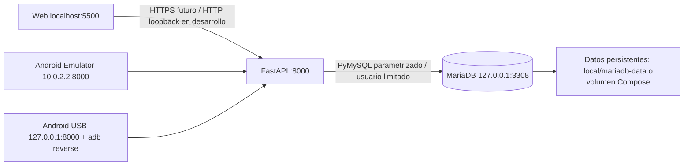

# Integración preoficial de LiceoMap

## Registro de trabajo y procedencia

Fecha de auditoría: 2026-10-24. Rama exclusiva: `feature/preoficial-integracion`.
No se realizan commits, push ni merges. El árbol inicial estaba limpio.

| Componente | Fuente publicada verificada tras fetch | Decisión |
|---|---|---|
| Web | `5f2308a` / `origin/feature/web-cinematic-intro` | Conservar narrativa y animaciones; sustituir solo administración simulada |
| API, database | `c93b0ce` / `origin/main` | Importación selectiva con `git restore --worktree` |
| Android | `150e580` / `origin/feature/android-m08-unified-design` | Importar android completo, conservar Compose/Material 3/MVVM |
| Documentación | `docs/api.md`, `docs/datos_prueba.md` de main | Referencias históricas; este documento define el arranque integrado |

No se depende de archivos del PC del liceo. La rama publicada Android se llama M08,
pero su último commit se describe como M07.1; se utiliza exactamente la fuente solicitada.
`web/app-admin.js` era un controlador antiguo no cargado, con contraseña fija y sesión
en localStorage. `web/app.js` contenía otro acceso simulado sin autenticación.
Ambos quedaron sustituidos por un solo flujo con la API.

## Puntos de control

| Etapa | Estado | Evidencia / archivos |
|---|---|---|
| A | Verificada | api/, database/, android/, dos documentos de referencia, .gitignore. Sin alteraciones a animaciones |
| B | Verificada | MariaDB portable 11.4.13; 127.0.0.1:3308; dev y test separadas; 132 usuarios sintéticos, cuatro cursos con 30 matrículas; 004/005 aplicadas; reinicialización rechazada sobre tablas existentes; persistencia comprobada |
| C | Verificada | 41 pruebas API pasan contra MariaDB test: permisos, destinatarios, CRUD lógico, atomicidad, historial, sesiones, CORS, privilegios mínimos |
| D | Verificada | Chrome `node web/tests/phase2.cjs --preoficial`: login, roles, CRUD real, XSS como texto, logout, herramientas pendientes deshabilitadas |
| E | Verificada en emulador | Retrofit/OkHttp, autenticación, /me, repositorios remotos, sesión en memoria, recarga y errores. 48 pruebas unitarias pasan |
| F | Verificada en emulador | Recorrido Chrome → API → MariaDB → Android completo; ocho pruebas originales Android pasan; persistencia, composición y movimiento cinematográfico pasan; debug y release compilan |

**Criterio central alcanzado:** un anuncio publicado desde el panel real apareció en
Android al actualizar; se editaron y retiraron publicaciones desde web y se observaron
los cambios sin reiniciar Android. La pérdida real de API mostró Error y la recuperación
volvió a Ready. Expiración y logout limpiaron sesión. Los permisos negativos se
verificaron en la base dedicada de pruebas. No hay commits, push, merges ni cambios
de referencias de otras ramas locales; el índice permanece vacío.

### Archivos principales por etapa

| Etapa | Archivos / decisión |
|---|---|
| A | api/, database/, android/ importados de sus fuentes; .gitignore; docs/api.md y docs/datos_prueba.md históricos |
| B | compose.yaml; scripts/local_db.py, mariadb-portable.ps1, stop_db.py; database/preoficial_migrations/004 y 005 |
| C | api/app/config.py, db.py, security.py, main.py, announcements.py; .env.example, requirements.lock; api/tests/ |
| D | web/app-admin.js, app.js (solo administración), index.html (solo imports y panel), admin.css |
| E | Android data/remote/, modelos de sesión, AppViewModel, SchoolContentViewModel y navegación; ajustes mínimos a las vistas; Gradle y manifiestos DEBUG |
| F | scripts/android.ps1, verify_sync.py, persistence.py; pruebas API/Android/web; preoficial-integrity.cjs y fixtures originales conservados |

Listado completo: [PREOFICIAL_ARCHIVOS.md](PREOFICIAL_ARCHIVOS.md).
Los secretos, datos persistentes, APKs e informes locales se excluyen de ese listado.

## Arquitectura integrada



Una sola API y base de **desarrollo** para web y Android. La verificación automatizada
usa otra base **test**, en la misma instancia dedicada, y API `8001`. Nunca ejecuta
pruebas de escritura contra la base de desarrollo ni una base institucional.

FastAPI conserva validación RUT, bcrypt, JWT, mapa y horarios de lectura. El router
`api/app/announcements.py` concentra anuncios; usa transacciones para registro e
historial. Cada JWT referencia una sesión revocable en MariaDB. Se comprueba usuario
activo y rol actual de BD en cada petición, sin confiar en el rol del token.

Web conserva HTML cinematográfico, GSAP, tipografía, CSS y narrativa originales.
`app.js` mantiene overlays y foco; `app-admin.js` es el único controlador de datos
administrativos. Bearer en una clausura de memoria, sin localStorage/sessionStorage.

Android mantiene Kotlin, Compose, Material 3 y MVVM. `RemoteClient` encapsula
Retrofit/OkHttp; repositorios remotos implementan los contratos existentes.
`AppViewModel` posee navegación/autenticación; `SchoolContentViewModel` posee
Loading/Ready/Error y descarta respuestas tardías de otra sesión. `MemorySession`
conserva identidad/bearer solo durante el proceso. Al morir el proceso hay que
autenticarse otra vez. `SchoolSession` permite reutilizar vistas sin convertir una
identidad real en `DemoSession`. El contenido remoto nunca usa datos demo de respaldo.

## Requisitos Windows y preparación

- Git; Python 3.14 (versión verificada), Node 22 o posterior y Chrome/Edge para regresión web.
- Docker Desktop operativo con Compose **o** MariaDB portable 11.4.13. No usar ambos
  simultáneamente en 3308. En este PC se eligió portable porque Docker no está instalado.
- Android Studio con JDK 25, SDK 37, build tools y emulador o dispositivo USB.
  En este PC: Java en `C:\Program Files\Android\Android Studio\jbr`, SDK en `D:\JS`, AVD `Pixel_10`.
- Gradle Wrapper 9.5.0 y AGP 9.3.2 originales. Retrofit 2.11.0, OkHttp 4.12.0.
- Ejecutar comandos desde la raíz del repositorio en PowerShell.

```powershell
python -m venv .venv
.\.venv\Scripts\python.exe -m pip install -r api/requirements.lock
.\.venv\Scripts\python.exe scripts/local_db.py secrets
```

`requirements.lock` fija el entorno Python comprobado. `requirements.txt` conserva
las dependencias declaradas de la fuente, para futuras actualizaciones deliberadas.
`secrets` es idempotente y no sobrescribe `api/.env` ni secretos existentes.
Archivos privados: `.local/database.env`, `.local/mariadb.env`, `api/.env` y
`.local/liceomap_preoficial_*.accounts.json`. No imprimirlos en informes, subirlos,
copiarlos al APK ni incluirlos en respaldos públicos. `.gitignore` los excluye junto
con entornos, binarios de herramientas, APKs, logs, respaldos y claves de firma.

## MariaDB: instalación nueva y arranque

### Opción empleada: portable, sin servicio de Windows

```powershell
powershell -NoProfile -ExecutionPolicy Bypass -File scripts/mariadb-portable.ps1 -Action Install
```

Descarga oficial, SHA256 fijado y comprobado, extracción en `.local/tools`, datadir
nuevo en `.local/mariadb-data`, root aleatorio y bind solo `127.0.0.1:3308`.
`Install` rechaza datadir existente o puerto ocupado. No modifica otros servicios.
El bypass de política afecta solo al proceso de PowerShell que ejecuta ese archivo.

### Alternativa: Docker Compose

Comprobar antes `docker info` y `docker compose version`. Con Docker operativo:

```powershell
docker compose up -d mariadb
docker compose ps
```

Se publica únicamente `127.0.0.1:3308`, imagen `mariadb:11.4.13`, volumen nombrado
`liceomap-preoficial_preoficial_mariadb`. No hay scripts destructivos en el entrypoint.
Esperar estado healthy. **No ejecutar `docker compose down -v` para reiniciar**:
el parámetro `-v` elimina los datos. Compose quedó preparado pero no ejecutado aquí.

### Inicialización segura (solo una vez, esquema vacío)

```powershell
.\.venv\Scripts\python.exe scripts/local_db.py init
.\.venv\Scripts\python.exe scripts/local_db.py init --test
```

El inicializador solo acepta dos nombres fijos (`liceomap_preoficial_dev` y
`liceomap_preoficial_test`), conexión loopback:3308 y root local generado. Obtiene un
lock SQL, comprueba `information_schema.tables` y **rechaza toda tabla previa**.
Solo entonces usa el esquema consolidado. Su `USE colegio_db` original se elimina
en memoria para que el SQL permanezca dentro de la base dedicada comprobada.
No se cambia el script histórico ni se permite elegir una base arbitraria.

Se conservan cursos/horarios sintéticos; se generan contraseñas distintas para los
132 usuarios y se retiran las siete publicaciones de ejemplo para que ninguna alerta
ficticia se presente como aviso institucional vigente. El usuario `20100008-4` queda
inactivo para verificar el rechazo de login. No son usuarios ni horarios validados
por el establecimiento.

Root se usa solo para instalación/migraciones. `liceomap_app` accede a dev y
`liceomap_test` a test; no tienen DDL, GRANT, DELETE ni escritura de usuarios/horarios.
Solo lectura en tablas de referencia; anuncios SELECT/INSERT/UPDATE; historial
SELECT/INSERT; sesiones SELECT/INSERT/UPDATE. La retirada es siempre lógica.

### Arranques posteriores y parada

```powershell
powershell -NoProfile -ExecutionPolicy Bypass -File scripts/mariadb-portable.ps1 -Action Start
powershell -NoProfile -ExecutionPolicy Bypass -File scripts/mariadb-portable.ps1 -Action Stop
```

En Docker: `docker compose stop mariadb` / `docker compose start mariadb`.
Mantener datadir/volumen. No ejecutar de nuevo `init` ni `Install`.

### Cambios de esquema posteriores

```powershell
.\.venv\Scripts\python.exe scripts/local_db.py migrate
.\.venv\Scripts\python.exe scripts/local_db.py migrate --test
```

Migraciones nuevas en `database/preoficial_migrations/`: 004 historial, 005 sesiones.
`schema_migrations` registra nombre y SHA256; no se repite una ya aplicada y se
rechaza modificar su contenido. Añadir otro archivo versionado para cambios futuros.
Las operaciones DDL de MariaDB no son transaccionales: hacer respaldo y ensayo antes
de migraciones futuras. Si una queda a medias, inspeccionar y reparar de forma
explícita; no reinicializar. `finish-seed` existe solo para finalizar la creación
interrumpida con un recibo `.initializing`; no importa ni elimina tablas.

## API y web

En terminales separadas, tras arrancar MariaDB:

```powershell
.\.venv\Scripts\python.exe scripts/run_api.py
.\.venv\Scripts\python.exe scripts/run_web.py
```

Web: `http://127.0.0.1:5500/` (también se permite origen `http://localhost:5500`).
API: `http://127.0.0.1:8000/health`; OpenAPI: `/docs`. Ambos servidores se limitan a
loopback. El servidor web sirve **solo web/**, nunca el repositorio ni `.local`.
Ctrl+C detiene esos servidores. No se monta el antiguo `api/test_client` en la API.
La URL web se configura con el meta `liceomap-api-base` en `web/index.html`.

| Ruta | Acceso y comportamiento |
|---|---|
| POST /auth/login | RUT válido, contraseña bcrypt completa de hasta 72 bytes; usuario activo; rate limit |
| GET /me | JWT vigente y sesión no revocada; devuelve nombre, rol y cursos activos |
| POST /auth/logout | Revoca la sesión; cliente borra memoria incluso sin conexión |
| GET /anuncios | Solo publicados; alumno ve globales y cursos con matrícula activa |
| POST /anuncios | dev, utp, inspectoria; valida curso activo; crea historial |
| PATCH /anuncios/{id} | Mismos roles; rechaza campos extra, nulos indebidos y anuncios retirados |
| DELETE /anuncios/{id} | Retirada `publicado=false`, idempotente; no borra registro ni historial |
| GET /admin/anuncios | Solo publicadores; filtros estado=todos/publicados/retirados y destinatario=global/id |
| GET /admin/cursos | Solo publicadores; opciones reales de destinatario |
| GET /admin/anuncios/{id}/historial | Solo publicadores; snapshots antes/después y actor |
| GET /cursos/{id}/horarios | Alumno solo curso propio; personal autenticado según permisos existentes |

HTTP 401 sesión inválida; 403 rol/curso denegado; 404 recurso no disponible; 409 edición
de anuncio retirado; 422 datos inválidos; 429 intentos excesivos; 503 BD no disponible.
Las validaciones no devuelven el input (podría contener contraseñas), ni detalles SQL.
El runner deshabilita access logs. El limitador en memoria aplica cinco fallos en
300 segundos por RUT/IP y por IP; se requiere un solo worker de API en este prototipo.
La BD y las conexiones usan UTC; JSON ISO 8601 incluye `+00:00`; las vistas muestran
fechas en `America/Santiago`.

## Android Emulator y USB

El código de red está en `data/remote/`. No hay conexión directa a MariaDB.
El manifiesto principal rechaza cleartext. Solo DEBUG añade una configuración que
admite HTTP a `10.0.2.2`, `127.0.0.1` y `localhost`, sin subdominios.
El cliente también valida destinos, desactiva redirects y no instala logging de HTTP.

```powershell
# Emulador: URL DEBUG predeterminada http://10.0.2.2:8000/
powershell -NoProfile -ExecutionPolicy Bypass -File scripts/android.ps1 -Action Build
# Instalar desde Android Studio o:
D:\JS\platform-tools\adb.exe install -r android/app/build/outputs/apk/debug/app-debug.apk
```

En este PC se verificó y dejó instalada la variante de desarrollo mediante loopback
y `adb reverse`, que también funciona en el emulador:

```powershell
powershell -NoProfile -ExecutionPolicy Bypass -File scripts/android.ps1 -Action RunLocal
```

Compila para `http://127.0.0.1:8000/`, instala y abre la app. El acceso de puente
`10.0.2.2` sigue disponible como configuración predeterminada; su conectividad en
este AVD no quedó validada. El recorrido completo se comprobó mediante reverse.

Para otro PC indicar `-Sdk RUTA -Java RUTA` al helper. En perfiles con acentos el
helper utiliza L: como alias temporal hacia la carpeta de usuario: evita que el
launcher Java interprete mal los classpath argument files UTF-8 de Gradle. No mueve
archivos y rechaza una L: ocupada por otra ruta. Se puede retirar el alias con
`subst L: /d` después de detener los procesos Gradle que lo usan.

Para celular USB: habilitar depuración USB, autorizar el PC y comprobar `adb devices`.

```powershell
D:\JS\platform-tools\adb.exe reverse tcp:8000 tcp:8000
# En terminal con JAVA_HOME y ANDROID_HOME configurados:
cd android
.\gradlew.bat assembleDebug -PliceomapApiBaseUrl=http://127.0.0.1:8000/
```

Instalar esa APK. `adb reverse` debe repetirse al reconectar el dispositivo.
Para futura producción configurar `-PliceomapApiBaseUrl=https://api.dominio/`.
Release usa por defecto `https://api.example.invalid/` hasta disponer de un servidor
real y no permite HTTP. No distribuir la variante apuntando a la API test `8001`.

## Prueba manual de sincronización

1. Arrancar MariaDB, API de desarrollo y web; abrir el panel administrativo.
2. Consultar **localmente**, sin pegar en este documento, las contraseñas generadas
   en `.local/liceomap_preoficial_dev.accounts.json`.
3. Usar UTP `20100002-5` o Inspectoría `20100003-3`. El panel debe mostrar su nombre
   y rol de API. Alumno `20100006-8` no debe poder entrar al panel.
4. En Android entrar con `20100006-8` (1F). Abrir Anuncios.
5. Desde web publicar un título único para Toda la comunidad; esperar confirmación
   real. Pulsar Actualizar anuncios en Android y comprobar título/contenido.
6. Publicar para 1F: visible para ese alumno; no para `20100007-6` (2A).
7. Editar desde web, actualizar Android; retirar desde web, actualizar Android:
   desaparece. En filtro Retirados sigue registrado para el administrador.
8. Interrumpir conexión, actualizar: Error, nunca datos demo. Recuperar y actualizar:
   Ready sin reiniciar la app. Expirar/revocar sesión: vuelve al acceso institucional.
9. Cerrar sesión: se limpia contenido e identidad. Reabrir no reutiliza contraseñas.
10. Reiniciar MariaDB conservando datadir/volumen y comprobar anuncios e historial.

Las cuentas `dev` y personal siguen existiendo como prueba, pero no hay editor de
usuarios, salas ni horarios. El mapa de presentación solo se muestra en modo demo.
En sesión real, Mapa indica en desarrollo. Los horarios remotos conservan el diseño;
sus datos locales son sintéticos y requieren validación institucional futura.

## Pruebas reproducibles y evidencias

```powershell
.\.venv\Scripts\python.exe -m pytest api/tests -q
powershell -NoProfile -ExecutionPolicy Bypass -File scripts/android.ps1 -Action Unit
node web/tests/phase2.cjs --phase53
node web/tests/phase2.cjs
```

Para probar el panel web aisladamente abrir terminales dedicadas:

```powershell
.\.venv\Scripts\python.exe scripts/run_api.py --test
.\.venv\Scripts\python.exe scripts/run_web.py --test
```

Para el recorrido integral, cerrar esos servidores y ejecutar:

```powershell
powershell -NoProfile -ExecutionPolicy Bypass -File scripts/android.ps1 -Action Sync
```

Cerrar la web de desarrollo antes de abrir su servidor test, que también usa 5500.
`--test` cambia el meta de API solo en la respuesta HTTP a 8001. `Sync` compila
una APK DEBUG para `127.0.0.1:8001`, instala app y test en el emulador y pasa las
credenciales como argumentos efímeros, nunca como BuildConfig ni propiedades Gradle.
Chrome publica/edita/retira con el panel real. El coordinador usa 5502 solo durante
la prueba para intercambiar etapas sin secretos. El helper inicia y detiene sus propios
servidores test, reconoce y cierra solo antiguos runners `--test` si ocupan esos puertos,
y rechaza un servidor web de desarrollo u otro proceso. Simula desconexión deteniendo
y reiniciando su proceso de API test; expira únicamente sesiones del alumno de la base test.
No ejecutar pytest ni otras pruebas de escritura a la vez que Sync.

Evidencias locales ignoradas: `.local/android-sync.log`, `.local/web-sync.log`,
`.local/review`, reportes JUnit en `android/app/build/test-results`. No sobrescribir
las capturas cinematográficas originales de `web/review`.

### Resultados finales y errores corregidos

| Verificación | Resultado observado |
|---|---|
| API contra MariaDB test | 41 passed; dos avisos de deprecación de librerías, sin fallos |
| Android unitarias | 48 tests, 0 failures |
| Android originales en Pixel_10 / API 37 | 8 tests, 0 failures |
| Sincronización Chrome → Android | 1 prueba integral: creación, edición, retirada, offline/online, expiración y logout; OK |
| Persistencia | SHA256 de anuncios e historial idéntico antes/después del reinicio en dev y test |
| Web conectada Chrome | Login válido/inválido, alumno rechazado, sesión falsificada rechazada, CRUD real, escape XSS, logout: PASS |
| Cinemática composición | Seis viewports conservan las composiciones originales; fixtures anteriores no se regeneraron |
| Cinemática movimiento | Rueda nativa, reversa, settling, accesibilidad, pausa admin, resize/orientación: PASS |
| Release | assembleRelease y lintVital pasan; APK sin configuración network_security_config DEBUG; manifiesto usesCleartextTraffic=false |
| Git | git diff --check pasa; índice vacío; feature/web-cinematic-intro y HEAD de integración siguen en 5f2308a |

Incidencias adicionales del verificador, resueltas antes de declarar el recorrido:

- Java/Gradle no encontraba GradleWorkerMain por el perfil Windows con acentos.
  El alias L: permitió ejecutar todas las pruebas unitarias.
- Chrome recibió rechazos intermitentes de conexiones al servir múltiples scripts.
  El servidor de desarrollo aumenta su backlog a 128; el coordinador conserva
  diagnósticos y reintenta acciones sin duplicar títulos del mismo recorrido.
- Se abandonaron marcadores por shell adb por su transporte de argumentos; ahora
  el canal de coordinación es HTTP local 5502 vía reverse, sin credenciales.
- Retirar un reverse no cerraba sockets HTTP existentes: la prueba de offline ahora
  detiene realmente la API test. Se usa el intérprete real para que el redirector
  del venv de Windows no deje vivo un proceso hijo.
- Una referencia `java.net.URI` chocó con la extensión Gradle `java`: import explícito,
  compilación debug y release comprobadas después de corregirla.
- Stop-Process produjo una excepción del host; el helper comprueba el proceso de
  pruebas y controla exclusivamente ese PID mediante System.Diagnostics.Process.
- Las comprobaciones históricas incluían hashes del panel simulado. Se conserva el
  fixture y se comparan las secciones cinematográficas contra 5f2308a, permitiendo
  únicamente los cambios administrativos solicitados. No se ajustaron animaciones.

Las verificaciones automáticas se acompañaron de inspección de estado y pantalla del
emulador. Falta aún la prueba manual por el usuario con celular físico. Docker no se
ejecutó en este equipo. Estas dos comprobaciones no se presentan como realizadas.

## Pendientes antes de producción

- HTTPS, dominio, proxy con cabeceras de seguridad y una política CSP compatible
  con la web; revisión de scripts externos y tratamiento de XSS.
- Separar infraestructura real y de pruebas; respaldos cifrados y restauración ensayada,
  rotación/gestor de secretos, usuarios institucionales verificados y retiro de seeds.
- Rate limiting distribuido y atómico, política de contraseñas altas/bajas, recuperación,
  MFA para personal y controles contra abuso. El limitador local se reinicia con la API.
- Ciclo de sesiones y revocación multi dispositivo, limpieza de sesiones antiguas.
  Si logout ocurre sin red, el bearer se borra localmente pero la sesión de servidor
  conserva su vigencia máxima de 60 minutos. No se conserva refresh token.
- Paginación: listados limitados a los últimos 500 anuncios. No se implementó reeditar
  ni republicar retirados; sus snapshots siguen consultables por administradores.
- Observabilidad sin datos sensibles, políticas de retención y tratamiento de información
  de estudiantes, revisión de permisos y recuperación ante migraciones DDL parciales.
- La configuración Compose requiere ejecución en un equipo con Docker operativo.
- Prueba USB con hardware físico y revisión de firma, distribución, accesibilidad y
  comportamiento de red en dispositivos reales antes de publicar Android.

## Errores observados

- El sandbox no permite locks de Git: fetch e importación selectiva necesitaron
  escalación, autorizada. No se modificó el índice ni otras ramas.
- Docker, Java y adb no están en PATH; se inspeccionan instalaciones antes de configurar.
- Java 25 está en Android Studio y SDK 37 en `D:\JS`. Compilación Android original
  `assembleDebug` pasó. Las pruebas unitarias originales fallan antes de ejecutarse:
  `ClassNotFoundException: worker.org.gradle.process.internal.worker.GradleWorkerMain`.
  Se investigará el entorno de workers; no se considera una prueba de diseño superada.
- Bootstrap inicial falló al interpolar el host SQL `%` junto a parámetros PyMySQL.
  Se parametrizó también el host. Se comprobó la base recién creada (132 usuarios,
  siete anuncios retirados), se recuperó con finish-seed sin DROP ni DELETE adicional,
  y se creó luego la base test desde cero correctamente.
- Archivo MariaDB verificado contra sha256sums oficial:
  `d62986d433eeebfde218560b276103831604a61e929e87f1a17f5aebd80257e2`.

## Seguridad de inicialización

`database/database.sql` contiene DROP TABLE y DELETE. Solo puede ejecutarse en una
instancia nueva, vacía, dedicada y comprobada. Las migraciones históricas 001–003
incluyen datos sintéticos y operaciones destructivas: no se ejecutan sobre la base
consolidada ni automáticamente sobre bases existentes.
